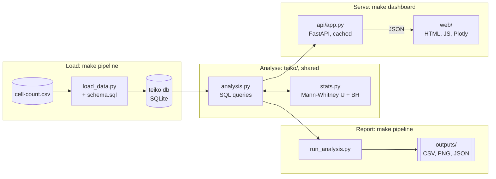
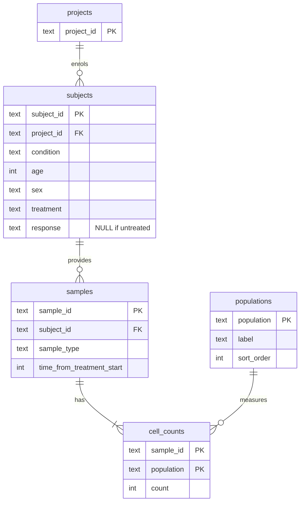

# Loblaw Bio: Immune Cell Profiling for the Miraclib Trial

A Python pipeline and interactive dashboard that answers Bob Loblaw's questions about how miraclib
affects immune cell populations. It loads `cell-count.csv` into SQLite, computes per-sample relative
frequencies, compares responders with non-responders, and summarises the baseline cohort.

## Quick start

In GitHub Codespaces (or any machine with Python 3.11+):

```bash
make setup       # create .venv and install dependencies
make pipeline    # build teiko.db and write all results to outputs/
make dashboard   # serve the dashboard
```

**Dashboard:** <http://localhost:8000>

`make dashboard` prints the URL it is actually using. If port 8000 is already taken it moves to the
next free port, so the command never fails on a busy port. In Codespaces the port is forwarded
automatically: open the **Ports** tab, or click the notification. If the database has not been
built yet, `make dashboard` runs the pipeline first.

Other targets: `make test` runs the test suite, `make lint` checks formatting, and `make clean`
removes generated files.

## Architecture



- **`make pipeline`** loads the CSV into `teiko.db`, then `run_analysis.py` writes every result to
  `outputs/`.
- **`teiko/`** holds the queries and statistics. The pipeline and the dashboard both use it, so the
  files in `outputs/` and the numbers on screen always match.
- **`make dashboard`** starts `serve.py`, which runs FastAPI. The API reads the database read-only
  and returns JSON, and the browser draws the tables and charts. If `teiko.db` is missing, the
  pipeline runs first.

## Repository layout

```
load_data.py          Part 1: create the schema and load the CSV into teiko.db (standard library only)
run_analysis.py       Parts 2-4: run every analysis and write the results to outputs/
serve.py              Start the dashboard server, with port fallback
teiko/
  schema.sql          Database schema
  config.py           Paths, population list, cohort definition
  db.py               Read-only database connection
  analysis.py         Queries and analyses for Parts 2-4 (shared by the pipeline and the API)
  stats.py            Mann-Whitney U tests with Benjamini-Hochberg correction
api/app.py            FastAPI: JSON endpoints and static file serving
web/                  Dashboard frontend (HTML, CSS, vanilla JS and Plotly; no build step)
tests/                pytest suite
```

### Pipeline outputs

| File | Contents |
| --- | --- |
| `outputs/frequency_table.csv` | Part 2 table: `sample, total_count, population, count, percentage` |
| `outputs/responder_stats.csv` | Part 3 tests, for all timepoints, each day, and the subject-averaged check |
| `outputs/responder_boxplot.png` | Part 3 boxplot |
| `outputs/baseline_samples.csv` | Part 4.1 sample list |
| `outputs/baseline_summary.json` | Part 4.2 counts |

## Part 1: Database schema



The schema is in [`teiko/schema.sql`](teiko/schema.sql). The Part 2 table is a view,
`sample_frequencies`, defined on top of it.

**Why this design**

- **Each fact is stored once.** Condition, age, sex, treatment and response describe the
  *subject*, not the sample. The CSV repeats them on all three of a subject's samples. The loader
  verifies they never disagree, then stores them once on `subjects`.
- **Cell counts are stored long, not wide.** `cell_counts` has one row per sample and population
  instead of one column per population. Adding a population, for example from a larger cytometry
  panel, is new rows rather than a schema migration. Per-population queries are plain `GROUP BY`s
  rather than five-way `UNION`s.
- **Constraints catch bad data at load time.** Foreign keys, `CHECK`s on sex, response and
  non-negative counts, and a composite primary key that blocks duplicate measurements.
- **Indexes match the access paths.** The analyses filter by condition and treatment, sample type
  and timepoint, and project.

**How it would scale to hundreds of projects and thousands of samples**

- The normalised model grows linearly. New projects, subjects and samples are only inserts.
- Per-sample totals are computed in a grouped subquery that SQLite can restrict to the samples
  being read. Filtered queries therefore don't re-aggregate the whole table.
- The natural next steps are:
  - a `sample_totals` table, or a materialised frequency table, refreshed on load;
  - an `assays` / `panels` table, so different projects can measure different populations;
  - a `timepoints` table for non-integer visit schedules;
  - moving to PostgreSQL once several people need to write concurrently.
- None of these change the core shape of the schema.

## Part 2: Relative frequencies

The `sample_frequencies` view returns one row per sample and population, with
`sample, total_count, population, count, percentage`. `percentage` is the population's count
divided by the sample's total across all five populations. That gives 10,500 samples × 5
populations = 52,500 rows, and each sample's percentages sum to 100.

In the dashboard the table is paged on the server. It can be searched by sample or subject ID,
filtered by project, condition, treatment, response, sex, sample type, day and population, and
sorted by any column. A summary bar above the table covers every matching row, not just the current
page: the number of samples and, once a single population is selected, its mean count and mean
frequency. **Export CSV** downloads exactly the filtered view. Selecting a row (by click, or with
the ↑/↓ keys) shows the sample in a docked **sample inspector**: its metadata and its subject's
composition across days 0, 7 and 14.

## Part 3: Responders vs non-responders

**Cohort:** melanoma patients treated with miraclib, PBMC samples only. That is 1,968 samples from
656 subjects (331 responders, 325 non-responders).

**Method**

- **Test:** a two-sided **Mann-Whitney U** test per population. It compares ranks, so it does not
  assume percentages are normally distributed, and it is robust to outliers.
- **Multiple testing:** five populations are tested at once, so p-values are adjusted with the
  **Benjamini-Hochberg** false discovery rate procedure. A population is called significant when
  its adjusted **q < 0.05**.
- **Repeated measures:** each subject contributes three samples (days 0, 7 and 14), and pooling them
  treats repeated samples from one patient as independent. Two checks address this:
  - the per-day views use exactly one sample per subject;
  - a robustness test averages each subject's samples into a single value per population.

**Results (all timepoints pooled)**

| Population | Median, responders | Median, non-responders | Difference | p | q (BH) |
| --- | ---: | ---: | ---: | ---: | ---: |
| B cell | 9.43% | 9.79% | −0.36 pp | 0.056 | 0.139 |
| CD8 T cell | 24.73% | 24.60% | +0.12 pp | 0.639 | 0.639 |
| **CD4 T cell** | **30.22%** | **29.66%** | **+0.56 pp** | **0.013** | **0.067** |
| NK cell | 14.51% | 14.80% | −0.29 pp | 0.121 | 0.202 |
| Monocyte | 19.61% | 19.94% | −0.33 pp | 0.163 | 0.204 |

**Conclusion**

- **CD4 T cells are the strongest candidate.** They are higher in responders (p = 0.013).
- **The result holds per subject.** Averaging each subject's samples gives p = 0.012, so counting
  the same patients several times does not explain it.
- **It narrowly misses significance after correction.** Accounting for five tests gives q = 0.067,
  so **no population differs significantly at q < 0.05**.
- **Treat CD4 T cells as a lead to confirm, not a finding.** The honest message for Barry is that
  this needs confirming in more patients.

**When the difference appears:** at **day 0, before treatment, responders and non-responders are
indistinguishable** (every q = 0.885). The CD4 T cell gap opens after treatment starts (day 7:
+0.90 pp, p = 0.030). By day 14 responders also show lower B cell frequencies (−0.73 pp,
p = 0.014, q = 0.072). Baseline frequencies of these five populations are therefore unlikely to
predict response on their own. Early on-treatment changes in CD4 T and B cells are the more
promising signal, and should be followed up with more subjects.

The dashboard shows the boxplot and test table for all timepoints or any single day. It also states
the conclusion in plain English and charts each population's mean over time by response group.

## Part 4: Baseline subset

**Melanoma PBMC samples at baseline (day 0) from miraclib-treated patients:** 656 samples.

| Breakdown | Counts |
| --- | --- |
| Samples per project | prj1: 384, prj3: 272 |
| Subjects by response | Responders: 331, Non-responders: 325 |
| Subjects by sex | Male: 344, Female: 312 |

The queries are in [`teiko/analysis.py`](teiko/analysis.py). The dashboard displays them verbatim
under "Show the SQL behind these numbers", and the sample list can be downloaded as CSV.

## Dashboard design

- **Backend: FastAPI** reads the read-only SQLite database.
  - The Part 2 table is paginated in SQL, so the browser never loads all 52,500 rows.
  - Part 3 and Part 4 results are computed once and cached, because the data is static while the
    server runs.
- **Frontend:** one hand-built page (HTML, CSS and vanilla JavaScript) with
  [Plotly.js](https://plotly.com/javascript/), using the cartesian bundle (about 1.3 MB) loaded
  from its CDN. There is no build step.
  - A sidebar holds navigation, dataset counts and the controls for the current view; the main area
    shows one view at a time (`#frequencies`, `#responders`, `#trends`, `#baseline`).
  - Each view fetches its data on first visit.
- **Visual language:** follows Teiko's product screens, such as the panel builder and deliverable
  reports on [teiko-labs.com](https://teiko-labs.com/deliverables):
  - IBM Plex Sans;
  - stacked sidebar cards with small uppercase labels;
  - outlined chips that turn coral when selected, and coral stat numbers;
  - status pills for test results.
- **Accessibility:**
  - responder and non-responder colours, and the five population colours, were checked for
    colour-blind separation;
  - every chart has a legend, and its numbers are also available as a table;
  - the layout adapts down to phone width.

## Tests

`make test` runs 12 tests. They cover:

- the load round-trip and the rejection of inconsistent subjects;
- the frequency table's shape and that each sample's percentages sum to 100;
- filtering and paging, and that the summary means match the raw CSV;
- the cohort definition and invariants of the statistics table;
- that the Part 4 counts add up;
- port fallback;
- a smoke test of every API endpoint.

The tests build their own temporary database, so they never modify `teiko.db`.
